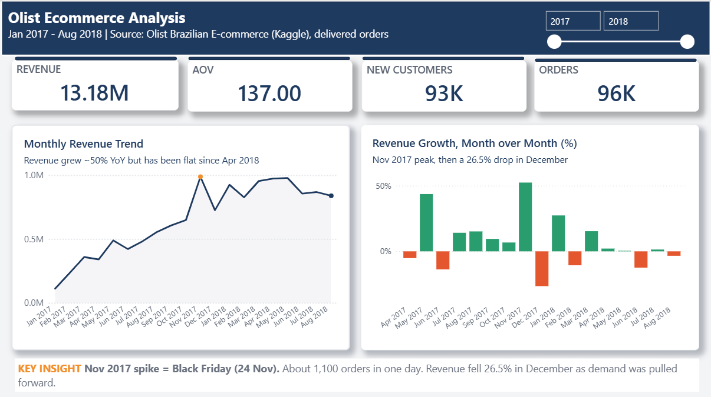
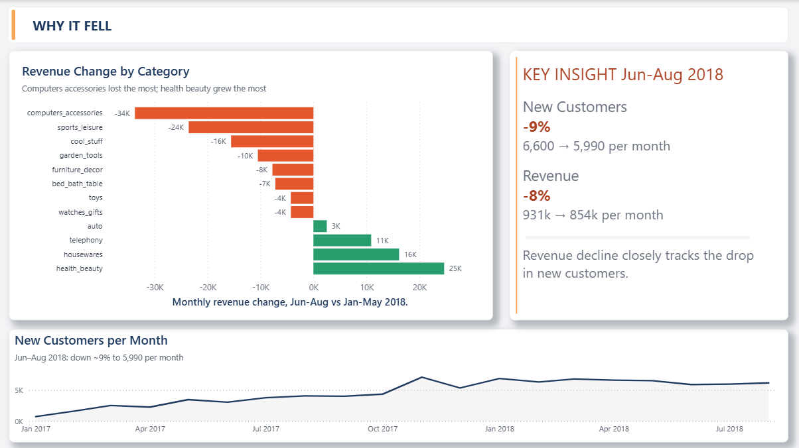
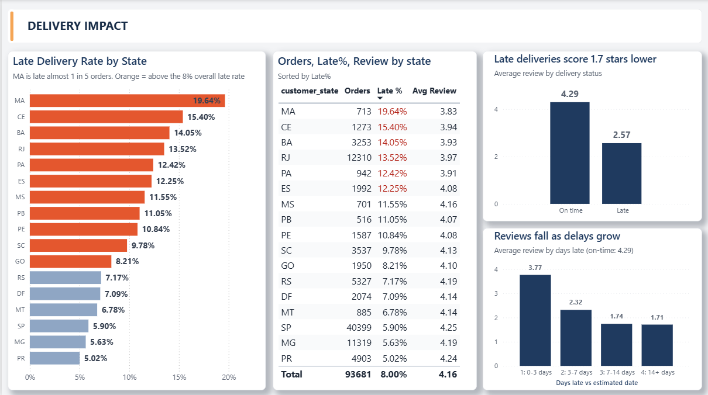
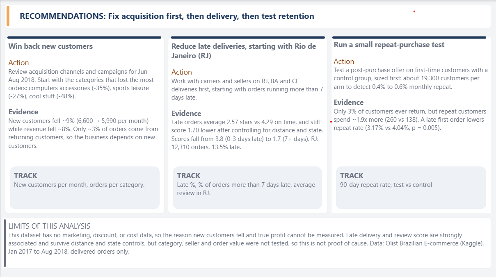

# Olist E-commerce: Business Performance Analysis

**Business question:** Revenue growth stalled in 2018. Where is the business losing value, why, and what should it fix first?

Built with PostgreSQL, Python (pandas, SciPy, statsmodels) and Power BI. Rebuilds end to end with one command: `python run_pipeline.py`.
Author: Bhumika Bhoyar | [GitHub](https://github.com/bhumikabhoyar) | [LinkedIn](https://linkedin.com/in/bhumika-bhoyar07)

---

## Dashboard

| Executive summary | Why it fell |
|---|---|
|  |  |

| Delivery impact | Recommendations |
|---|---|
|  |  |

---

## Dataset

[Olist Brazilian E-Commerce Public Dataset](https://www.kaggle.com/datasets/olistbr/brazilian-ecommerce) (Kaggle): 9 tables, about 100k real orders from 2016 to 2018. Amounts are in Brazilian reais.

**Scope of the analysis:** delivered orders from Jan 2017 to Aug 2018 (96,211 orders, about 13.18M revenue). Revenue is defined as item price; freight is tracked separately.

---

## Method

1. **Data quality checks (SQL):** row counts, duplicate keys, orphan records, order status mix, null dates, date range, price sanity.
2. **Cleaning decisions**
   - Excluded Sep-Dec 2016 and Sep-Oct 2018: near-empty months, not real collapses.
   - Counted revenue for delivered orders only (97% of orders).
   - Kept the 547 orders with several reviews by keeping the latest review per order, so joins do not duplicate revenue.
   - Kept high-priced items (max 6,735) because they look genuine; reported median next to mean (mean 119.96, median 74.90).
3. **Analysis (SQL):** monthly KPIs, MoM growth, category volume vs price, new vs returning customers, late delivery by state, monthly cohort retention.
4. **Statistics (Python)**
   - Welch t-test and Mann-Whitney on review scores, confidence interval, Cohen's d.
   - Within-state check for Simpson's paradox.
   - **Confounder control:** seller-to-customer distance (haversine on zip-prefix centroids) as quartiles, plus an OLS regression with robust errors controlling for distance and state (used to explain, not to predict).
   - **Dose-response:** review score by how many days late an order arrived.
   - Two-proportion z-test on repeat purchase, and a power calculation for the proposed test.
5. **Pipeline:** `run_pipeline.py` loads the 9 CSVs, builds the views from `sql/build_views.sql`, runs 5 data checks (unique keys, no orphans, one review per order, revenue reconciles to 13.18M) and writes a `kpi_monthly` table.
6. **Dashboard (Power BI + DAX):** star-style model with an order-level fact table and an item-level fact table.

---

## Key findings

1. **Growth stalled in 2018.** Revenue is up about 51% year over year (Aug 2018 vs Aug 2017) but has been flat or falling month to month since April 2018 (peak 978k in May 2018, 839k in Aug 2018).
2. **Black Friday distorted late 2017.** Nov 2017 had 7,289 orders, then revenue fell 26.5% in December, so demand was pulled forward.
3. **The Jun-Aug 2018 dip tracks fewer new customers.** Compared with Jan-May 2018, new customers fell about 9% (6,600 to 5,990 per month) and revenue fell about 8% (931k to 854k per month).
4. **The decline is concentrated in a few categories.** computers_accessories, sports_leisure and cool_stuff lost the most revenue, mainly through fewer orders rather than lower prices.
5. **Late deliveries hurt reviews badly.** About 8% of delivered orders arrive late (about 1.16M revenue). Late orders average 2.57 stars vs 4.29 on time (difference -1.73, 95% CI -1.77 to -1.69, Cohen's d -1.45, p < 0.001). The gap holds inside SP, MG, RJ and BA.
6. **The late-delivery effect is not a distance effect.** After controlling for distance and state, late orders still score 1.70 stars lower (95% CI -1.74 to -1.67). Late rate does rise with distance (6.3% in the nearest quartile to 10.2% in the farthest), but within every distance quartile late orders score 1.3 to 1.8 stars lower.
7. **Review scores fall with how late the order is.** Average review: 3.77 for 0-3 days late, 2.32 for 3-7, 1.74 for 7-14 and 1.70 beyond 14 days (about 4.29 on time). The drop flattens after a week. Late orders in the nearest quartile arrive a median 2.9 days late, versus 6.6 to 6.9 days in the others, which matches their smaller review gap.
8. **Retention is very low.** Only about 3% of customers order again, and in every 2017 cohort fewer than 1% come back in any given month (month 1, 3 or 6). Customers whose first order was late repeat less (3.17% vs 4.04%, p = 0.005). Repeat customers spend about 1.9x more (260 vs 138).

---

## Recommendations

1. **Win back new customers.** Review acquisition channels and campaigns for Jun-Aug 2018, starting with the three categories above. Track new customers per month and orders per category.
2. **Reduce late deliveries, starting with Rio de Janeiro, and prioritize the severe cases.** RJ has about 12,300 orders and a 13.5% late rate. Orders more than 7 days late are about 3.4% of orders but score about 1.7 stars. Track Late %, % of orders more than 7 days late, and average review in RJ.
3. **Size and run a repeat-purchase test.** Monthly repeat is under 1%, so detecting a lift from 0.4% to 0.6% needs about 19,300 customers per arm (alpha 0.05, power 0.8). Even one extra point of repeat rate adds under 1% to revenue, so test before scaling. Track 90-day repeat rate.

---

## Limitations

- No cost, discount or marketing data, so true profit and the reason new customers fell cannot be measured.
- Late delivery and review score are strongly associated and survive distance and state controls, but other factors (category, seller, order value) were not tested, so this is not proof of cause.
- Distance is a straight line between zip-prefix centroids, not road distance, and orders without coordinates are left out of the distance analysis.
- Cohort retention rates rest on small counts (for example 0.28% of a 718-customer cohort is 2 people), so read them as a level, not a trend.
- Only one earlier year of data, so seasonality cannot be fully separated from trend.
- Recent months may understate late rates because slow orders may not be delivered yet.

---

## Repository structure

```
olist-ecommerce-analysis/
├── run_pipeline.py   one-command rebuild: load, views, checks, KPI table
├── sql/              build_views.sql (all views) and the numbered analysis scripts
├── notebooks/        01_load_data.ipynb, 02_statistics.ipynb
├── powerbi/          dashboard.pbix
├── docs/             dashboard screenshots
└── data/             raw CSVs (not committed, download from Kaggle)
```

## How to run

1. Download the dataset from Kaggle into `data/`.
2. Create a PostgreSQL database named `olist`.
3. Set your password (Windows): `set PGPASSWORD=your_password`, or type it when prompted.
4. Run `python run_pipeline.py` (loading the 1M-row geolocation table takes a minute or two). It ends with "pipeline finished OK" when all 5 checks pass.
5. Run `notebooks/02_statistics.ipynb` for the statistics.
6. Open `powerbi/dashboard.pbix` and point it to your local PostgreSQL.
